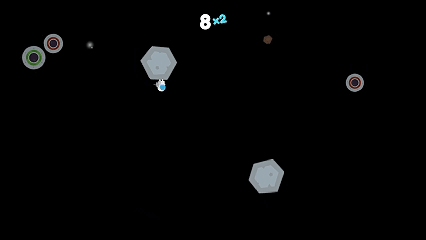

# Astro Leap

A fast-paced arcade game made with Unity. Leap between rotating asteroids, chain combos, and try not to fall into the void.

[**Play in your browser on itch.io**](https://devhex.itch.io/astro-leap)

[](gameplay.gif)

## About

Astro Leap started in 2025 as a small project to practice physics-based movement, camera systems and responsive controls. I then polished it into a complete game.

## How It Works

You stand on a rotating asteroid. It starts to shatter under you, so you have to leap to the next one before it falls apart. If you wait too long, you are launched automatically. Miss the next asteroid and you fall into the void.

## Features

- **Skill-based jumping:** time your leap from one asteroid to the next.
- **Combo system:** every landing adds to your multiplier. If you wait too long, it resets.
- **Dynamic camera:** Cinemachine zooms to fit the current and next asteroid and shakes the screen on every jump.
- **Visual effects:** particle explosions and a multi-stage shatter animation on asteroids.
- **Audio manager:** one central manager for music and sound effects, with random pitch variation.
- **Animated UI:** score pop animations, a typewriter-style death message and a counting score.
- **Best score:** saved locally with `PlayerPrefs`.

## Controls

| Input | Action |
|---|---|
| Left click | Leap off the current asteroid |

Use the **Play** button in the menu to start a run.

## Getting Started

**Requirements**

- Unity **6000.0.41f1** (Unity 6.0 LTS)
- LeanTween from the Unity Asset Store (not included in this repository)

Cinemachine 3.1.3, Input System, URP and TextMeshPro are installed automatically through the Package Manager.

**Run the project**

1. Clone the repository:

   ```bash
   git clone https://github.com/Yair-Bakshan/Astro-Leap.git
   ```

2. Open the folder in Unity Hub with Unity 6000.0.41f1.
3. Import LeanTween into `Assets/LeanTween/`.
4. Open `Assets/Scenes/Menu.unity` and press **Play**.

The `Menu` and `Game` scenes are already in the Build Settings, and the audio clips are already assigned.

## Project Structure

Scripts are in `Assets/Scripts`.

| Script | Responsibility |
|---|---|
| `Player.cs` | Jump physics, asteroid alignment and fall detection |
| `GameManager.cs` | Score, combo, best score and the death screen |
| `SpawnManager.cs` | Procedural asteroid spawning |
| `Asteroid.cs` | Rotation and the shatter stages |
| `CustomCamera.cs` | Cinemachine zoom and camera shake |
| `AudioManager.cs` | Music and sound effects |
| `MenuManager.cs` | Menu scene and the Play button |

## Credits

- Audio: created by Yair Bakshan
- Font: Fredoka Bold

## License

Released under the [MIT License](LICENSE).
